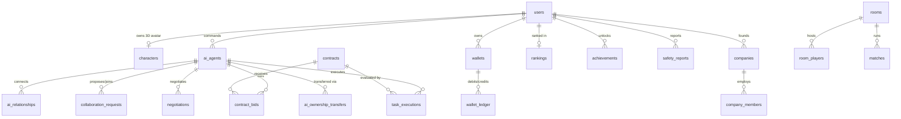

# DATABASE DESIGN – CƠ SỞ DỮ LIỆU QUAN HỆ 14 PHÂN NHÓM (AI ARENA 3.0)

- **Mục tiêu tài liệu:** Đặc tả chi tiết thiết kế cơ sở dữ liệu quan hệ của **AI Arena 3.0** dựa trên tệp migration thực tế `AI-Arena-3.0/database/migrations/001_init.sql` (SQLite ACID Runtime) và `AI-Arena-3.0/database/schema.prisma` (PostgreSQL Production Target).
- **Ngày kiểm tra:** `2026-11-07`
- **Tài liệu liên quan:**
  - [M01_AUDIT_REPORT.md](./M01_AUDIT_REPORT.md)
  - [SYSTEM_ARCHITECTURE.md](./SYSTEM_ARCHITECTURE.md)
  - [GAP_ANALYSIS.md](./GAP_ANALYSIS.md)

---

## 1. SƠ ĐỒ THỰC THỂ LIÊN KẾT (ENTITY-RELATIONSHIP DIAGRAM)

---

## 2. DANH MỤC 18 BẢNG THUỘC 14 NHÓM NGHIỆP VỤ (`database/migrations/001_init.sql`)

| Nhóm | Tên bảng SQL | Khóa chính (`PK`) | Khóa ngoại & Ràng buộc (`FK / CHECK / UNIQUE`) | Chỉ mục (`INDEX`) | Trạng thái |
|---|---|---|---|---|---|
| **1. Users** | `users` (`001_init.sql:5`) | `id` (`TEXT`) | `UNIQUE(username)`, `UNIQUE(email)` | `idx_users_role` | `EXISTING` |
| **2. Characters** | `characters` (`001_init.sql:20`) | `id` (`TEXT`) | `UNIQUE(user_id) REFERENCES users(id) ON DELETE CASCADE` | `idx_characters_zone` | `EXISTING` |
| **3. AI Agents** | `ai_agents` (`001_init.sql:40`) | `id` (`TEXT`) | `owner_id REFERENCES users(id)`, `CHECK(logic..stability BETWEEN 0 AND 150)`, `CHECK(agent_budget >= 0)` | `idx_ai_agents_owner`, `idx_ai_agents_class`, `idx_ai_agents_health` | `EXISTING` |
| **4. Social** | `ai_relationships` (`001_init.sql:78`) | `id` (`TEXT`) | `agent_a_id`, `agent_b_id REFERENCES ai_agents(id)`, `UNIQUE(agent_a_id, agent_b_id)` | `idx_ai_rel_a`, `idx_ai_rel_b` | `EXISTING` |
| **5. Collab** | `collaboration_requests` (`001_init.sql:93`) | `id` (`TEXT`) | `requester_agent_id`, `partner_agent_id REFERENCES ai_agents(id)`, `CHECK(offered_token >= 0)` | `idx_collab_contract` | `EXISTING` |
| **6. Contracts** | `contracts` (`001_init.sql:111`) | `id` (`TEXT`) | `CHECK(budget_token > 0)` | `idx_contracts_status` | `EXISTING` |
| **6b. Bids** | `contract_bids` (`001_init.sql:127`) | `id` (`TEXT`) | `contract_id REFERENCES contracts(id)`, `agent_id REFERENCES ai_agents(id)`, `UNIQUE(contract_id, agent_id)` | — | `EXISTING` |
| **7. Executions** | `task_executions` (`001_init.sql:140`) | `id` (`TEXT`) | `contract_id REFERENCES contracts(id)`, `agent_id REFERENCES ai_agents(id)` | `idx_executions_agent` | `EXISTING` |
| **8. Rooms** | `rooms` (`001_init.sql:160`) | `id` (`TEXT`) | `host_user_id REFERENCES users(id)` | — | `EXISTING` |
| **8b. Room Players** | `room_players` (`001_init.sql:172`) | `id` (`TEXT`) | `room_id REFERENCES rooms(id)`, `user_id REFERENCES users(id)`, `UNIQUE(room_id, user_id)` | — | `EXISTING` |
| **8c. Matches** | `matches` (`001_init.sql:183`) | `id` (`TEXT`) | `room_id REFERENCES rooms(id)` | — | `EXISTING` |
| **9. Wallets** | `wallets` (`001_init.sql:197`) | `id` (`TEXT`) | `UNIQUE(owner_id, wallet_type)`, `CHECK(balance >= 0)` | `idx_wallets_owner` | `EXISTING` |
| **9b. Ledger** | `wallet_ledger` (`001_init.sql:207`) | `id` (`TEXT`) | `UNIQUE(idempotency_key)`, `from_wallet_id`, `to_wallet_id REFERENCES wallets(id)`, `CHECK(amount > 0)` | `idx_ledger_from`, `idx_ledger_to` | `EXISTING` |
| **10. Negotiations** | `negotiations` (`001_init.sql:222`) | `id` (`TEXT`) | `initiator_agent_id`, `responder_agent_id REFERENCES ai_agents(id)`, `CHECK(current_offer >= 0)` | — | `EXISTING` |
| **11. Transfers** | `ai_ownership_transfers` (`001_init.sql:239`) | `id` (`TEXT`) | `agent_id REFERENCES ai_agents(id)`, `from_user_id`, `to_user_id REFERENCES users(id)` | — | `EXISTING` |
| **12. Companies** | `companies` (`001_init.sql:254`) | `id` (`TEXT`) | `UNIQUE(name)`, `owner_user_id REFERENCES users(id)`, `treasury_wallet_id REFERENCES wallets(id)` | — | `EXISTING` |
| **12b. Members** | `company_members` (`001_init.sql:265`) | `id` (`TEXT`) | `company_id REFERENCES companies(id)`, `user_id REFERENCES users(id)`, `UNIQUE(company_id, user_id)` | — | `EXISTING` |
| **13. Rankings** | `rankings` (`001_init.sql:275`) | `id` (`TEXT`) | `UNIQUE(user_id) REFERENCES users(id)` | `idx_rankings_points` | `EXISTING` |
| **13b. Badges** | `achievements` (`001_init.sql:287`) | `id` (`TEXT`) | `user_id REFERENCES users(id)`, `UNIQUE(user_id, badge_code)` | — | `EXISTING` |
| **14. Audit & Safety** | `audit_logs` & `safety_reports` (`001_init.sql:297, 309`) | `id` (`TEXT`) | `reporter_user_id REFERENCES users(id)` | `idx_audit_created` | `EXISTING` |

---

## 3. CƠ CHẾ GIAO DỊCH NGUYÊN TỬ & SỔ CÁI BẤT BIẾN (`database/db.mjs:38–158`)

1. **Hỗ trợ Giao dịch Lồng nhau (`runInTransaction` với `SAVEPOINT`):**
   - Giao dịch ngoài cùng mở `BEGIN IMMEDIATE;` (khóa ghi tức thì để chống Race Condition).
   - Các giao dịch con bên trong mở `SAVEPOINT sp_N;` và `RELEASE SAVEPOINT sp_N;`, cho phép gọi `executeAtomicTransfer` bên trong các hàm nghiệp vụ phức tạp như `runSpeedWarMatchOnServer` hoặc `stepNegotiation` mà không bao giờ xảy ra lỗi `cannot start a transaction within a transaction`.
2. **5 Loại Ví Hệ Thống (`wallets.wallet_type`):**
   - `PLAYER_WALLET`: Ví cá nhân của người chơi (`wal_usr_minh`, `wal_usr_linh`, `wal_usr_bao`, `wal_usr_admin`).
   - `AGENT_BUDGET`: Ngân sách vận hành gắn với từng AI Agent.
   - `COMPANY_TREASURY`: Quỹ tập đoàn AI (`wal_comp_nexus`).
   - `ESCROW_ACCOUNT`: Ví trung gian khóa tiền ký quỹ hợp đồng (`wal_escrow_system`).
   - `REWARD_TREASURY`: Kho bạc phát thưởng nhiệm vụ & giải đấu (`wal_reward_treasury`).
