# ROADMAP – LỘ TRÌNH PHÁT TRIỂN VERTICAL SLICES (M01 – M10 / VS01 – VS14)

- **Mục tiêu tài liệu:** Xác lập lộ trình phát triển chuẩn hóa cho **Đấu Trường AI – AI Arena 3.0** theo từng lát cắt dọc (**Vertical Slices `VS01` → `VS14`**) tương ứng với các giai đoạn **Sprint `M01` → `M10`**, ưu tiên luồng trải nghiệm cốt lõi có thể chơi thật:
  **`Login → Character → World → Room → AI → Contract (3 Chặng) → Speed War → Reward`** trước khi mở rộng sang giao dịch phức tạp và tập đoàn.
- **Ngày kiểm tra:** `2026-11-07`
- **Tài liệu liên quan:**
  - [M01_AUDIT_REPORT.md](./M01_AUDIT_REPORT.md)
  - [GAP_ANALYSIS.md](./GAP_ANALYSIS.md)
  - [IMPLEMENTATION_PLAN.md](./IMPLEMENTATION_PLAN.md)
  - [M01_BACKLOG.md](./M01_BACKLOG.md)

---

## 1. SƠ ĐỒ THỨ TỰ TRIỂN KHAI CÁC SPRINT (M01 → M10)

```mermaid
flowchart LR
  M01["M01: Audit, Foundation\n& Gzip/Touch Fixes"] --> M02["M02: 3D World Collision,\nJWT Auth & GLTF Pipeline"]
  M02 --> M03["M03: Multiplayer Rooms,\nMatchmaking & WS Tick"]
  M03 --> M04["M04: AI Agent Core,\nSkill Tree & Autonomy Cron"]
  M04 --> M05["M05: 3-Stage Contracts\n& Interactive Speed War"]
  M05 --> M06["M06: Token Economy\n& Safe-Mode P2P Caps"]
  M06 --> M07["M07: AI Social Network\n& Trust Evolution"]
  M07 --> M08["M08: AI Collaboration\n& Escrow Watchdog"]
  M08 --> M09["M09: AI Rescue Market\n& 2-Step Buyout"]
  M09 --> M10["M10: Corporation Dividends,\nLive Ops & Admin"]
```

---

## 2. BẢNG ÁNH XẠ 14 VERTICAL SLICES (`VS01` – `VS14`)

| Slice ID | Tên Vertical Slice | Sprint mục tiêu | Trạng thái hiện tại trong Repo | Mục tiêu nâng cấp ở Sprint tiếp theo |Ưu tiên |
|---|---|---|---|---|---|
| **VS01** | **Login, Character & 3D World** | `M01–M02` | `EXISTING` (Đã có 9 khu vực 3D, Tap-to-Move, Touch Ring, 4 tài khoản mẫu) | Bổ sung JWT Session Token + va chạm vật lý quanh chân tòa nhà 3D (`Circle Collider`). | **P0** |
| **VS02** | **Multiplayer Presence & Safe Chat** | `M02–M03` | `EXISTING` (RFC 6455 WS `MOVE_3D`, `ROOM_CHAT`, `sanitizeSafeChat`) | Bổ sung nội suy vận tốc (`Dead Reckoning`) và giới hạn tần suất gói tin di chuyển (`25Hz`). | **P1** |
| **VS03** | **Rooms, Team Select & Ready Check** | `M03` | `EXISTING` (`/api/rooms/create`, `/join`, `/ready`) | Thêm hàng đợi ghép trận tự động theo điểm Rating (`Matchmaking Queue`) và tự động bắt đầu khi 100% Ready. | **P1** |
| **VS04** | **AI Manager, Training & Autonomy** | `M04` | `EXISTING` (6 lớp AI, 6 chỉ số, 3 mức tự chủ, `Emergency Stop`) | Thêm cây kỹ năng mở khóa ở cấp 5/10/15 và bộ đếm tự động reset `daily_token_spent` lúc 00:00 UTC. | **P1** |
| **VS05** | **Contract Engine & 3-Stage Quests** | `M05` | `EXISTING` (Nhiệm vụ 3 chặng ghi rõ từng AI phụ trách, đấu thầu & nhận thưởng) | Cho phép người chơi hoặc công ty tự đăng hợp đồng mới (`Custom Contract Publishing`) có ký quỹ trước. | **P1** |
| **VS06** | **AI Speed War (3 Rounds)** | `M05` | `EXISTING` (Chấm điểm 3 vòng Server-Authoritative `40/25/15/10/10`) | Bổ sung chế độ đếm ngược từng vòng (`Round 1 -> 15s -> Round 2 -> 15s -> Round 3`) để đổi chiến thuật giữa trận. | **P1** |
| **VS07** | **Wallet & Immutable Reward Ledger** | `M06` | `EXISTING` (5 loại ví, `wallet_ledger` bất biến, `idempotency_key`, mưa Token 3D) | Thêm xuất báo cáo sao kê CSV/JSON và biểu đồ biến động số dư theo thời gian. | **P0** |
| **VS08** | **P2P Token Transfer & Agent Funding** | `M06` | `EXISTING` (`/api/wallet/transfer`, phát hiện giao dịch vòng tròn `Wash-Trading`) | Áp dụng trần chuyển Token ngày (`<= 200 TKN/ngày`) cho tài khoản học sinh (`safe_mode = 1`). | **P1** |
| **VS09** | **AI Social Relationships** | `M07` | `EXISTING` (`ai_relationships`, 5 cấp độ tin cậy, Rate Limit `5/phút`) | Thêm hiệu ứng cộng thêm `+5% Collaboration` khi 2 AI cùng đội đạt cấp `STRATEGIC_ALLIANCE`. | **P2** |
| **VS10** | **AI Autonomous Collaboration** | `M08` | `EXISTING` (`analyzeContractForAgent`, đề xuất ghép cặp AI bổ sung kỹ năng thiếu) | Thêm giao diện kéo-thả ghép cặp 2 AI trực tiếp trên sơ đồ 3 chặng hợp đồng. | **P2** |
| **VS11** | **AI Bounded Negotiation & Escrow** | `M08` | `EXISTING` (`stepNegotiation` tối đa 5 vòng, khóa & giải ngân `wal_escrow_system`) | Thêm tiến trình `Escrow Timeout Watchdog` tự động hoàn trả Token nếu quá hạn hợp đồng. | **P2** |
| **VS12** | **AI Rescue Market** | `M09` | `EXISTING` (`computeRescueStatus`, gói tài trợ đồng đẳng `PEER_RESCUE_GRANT`) | Thêm bảng thông báo khẩn cấp trên 3D Central Hub khi có AI rơi vào trạng thái `RESCUE_NEEDED`. | **P2** |
| **VS13** | **AI Acquisition & Ownership Transfer** | `M09` | `EXISTING` (`ACQUISITION_BUYOUT` bắt buộc `ownerConfirmed = true`) | Thêm tính năng chủ sở hữu niêm yết giá bán công khai (`Public Ask Price`) và lịch sử định giá AI. | **P2** |
| **VS14** | **Corporation, Live Ops & Admin Console** | `M10` | `EXISTING` (`companies`, `safety_reports`, `/api/admin/audit-economy`) | Thêm chia cổ tức tự động hàng tuần từ `COMPANY_TREASURY` cho các thành viên tập đoàn. | **P3** |
