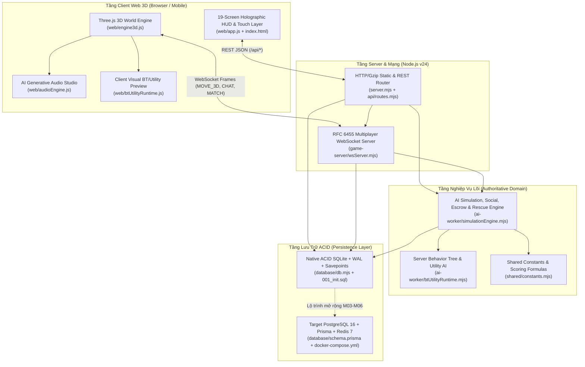

# SYSTEM ARCHITECTURE – ĐẤU TRƯỜNG AI (AI ARENA 3.0)

- **Mục tiêu tài liệu:** Định nghĩa kiến trúc hệ thống hiện tại (Verified Runtime Architecture) và kiến trúc mục tiêu chuẩn hóa (Target Modular Architecture), phân định rõ ranh giới 13 module, hợp đồng giao tiếp API/WebSocket và kiến trúc bảo mật Server-Authoritative.
- **Ngày kiểm tra:** `2026-11-07`
- **Tài liệu liên quan:**
  - [M01_AUDIT_REPORT.md](./M01_AUDIT_REPORT.md)
  - [GAP_ANALYSIS.md](./GAP_ANALYSIS.md)
  - [DATABASE_DESIGN.md](./DATABASE_DESIGN.md)
  - [ROADMAP.md](./ROADMAP.md)

---

## 1. SƠ ĐỒ KIẾN TRÚC TỔNG THỂ (VERIFIED RUNTIME & TARGET HYBRID)

---

## 2. QUY ĐỊNH RANH GIỚI 13 MODULE (PHASE E1 – MODULE BOUNDARIES)

Để đảm bảo mã nguồn không bị phụ thuộc chéo (Circular Dependency) khi nâng cấp từ Vanilla ESM lên React + TypeScript ở các Sprint tiếp theo, hệ thống được chia thành **13 Module độc lập**:

| STT | Tên Module | File hiện tại (Đã xác minh) | Quyền sở hữu dữ liệu (Data Ownership) | Chỉ được phép gọi (Allowed Dependencies) |
|---|---|---|---|---|
| 1 | **Client Rendering (3D)** | `web/engine3d.js`, `web/audioEngine.js` | Scene graph `THREE.Scene`, `heroMeshes`, `autonomousBots`, `WebAudio` nodes | `UI State`, `Shared Constants` |
| 2 | **UI State & HUD** | `web/app.js`, `web/index.html`, `web/styles.css` | `AppState`, trạng thái đóng/mở 19 màn hình, `quests` tracker | `Client Rendering`, REST `/api/*`, WS Client |
| 3 | **Game State & Presence** | `game-server/wsServer.mjs` (`clients`, `worldPlayers`) | Vị trí thời gian thực `(x, y, z, rotY, zone, animState)` của người chơi đang online | `Database (characters)`, `Authentication` |
| 4 | **Authentication & Safety** | `api/routes.mjs` (`/api/auth/*`), `database/db.mjs` (`hashPassword`) | Bảng `users` (`role`, `age_group`, `safe_mode`, `password_hash`) | `Database`, `Audit Log` |
| 5 | **Rooms & Matchmaking** | `api/routes.mjs` (`/api/rooms/*`), `wsServer.mjs` | Bảng `rooms`, `room_players` (`team`, `is_ready`, `selected_agent_id`) | `Game State`, `Database` |
| 6 | **Match Engine (Speed War)** | `game-server/wsServer.mjs` (`runSpeedWarMatchOnServer`) | Bảng `matches`, `rankings`, công thức `evaluateSpeedWarExecution` | `Rooms`, `Economy (Wallet)`, `AI Agent` |
| 7 | **AI Agent Core** | `api/routes.mjs` (`/api/agents/*`), `ai-worker/btUtilityRuntime.mjs` | Bảng `ai_agents` (6 chỉ số, `level`, `xp`, `agent_budget`) | `Economy`, `Shared Constants` |
| 8 | **Contract Engine** | `api/routes.mjs` (`/api/contracts/*`), `simulationEngine.mjs` (`analyzeContractForAgent`) | Bảng `contracts`, `contract_bids`, `task_executions` | `AI Agent`, `Economy` |
| 9 | **Economy & Wallet Ledger** | `database/db.mjs` (`executeAtomicTransfer`) | Bảng `wallets`, `wallet_ledger` (`idempotency_key`) | `Database Transaction`, `Audit Log` |
| 10 | **AI Social Network** | `ai-worker/simulationEngine.mjs` (`sendAiSocialRequest`) | Bảng `ai_relationships` (`level`, `trust_score`, `interaction_count`) | `AI Agent`, `Audit Log` |
| 11 | **Collaboration & Negotiation** | `ai-worker/simulationEngine.mjs` (`initiateCollaborationAndNegotiation`, `stepNegotiation`) | Bảng `collaboration_requests`, `negotiations` (`escrow_amount`, `round_count`) | `Economy (Escrow)`, `AI Social`, `Contract Engine` |
| 12 | **Trading & Rescue Market** | `ai-worker/simulationEngine.mjs` (`handleRescueMarketAction`) | Bảng `ai_ownership_transfers` (`owner_confirmed`, `price_token`) | `Economy`, `AI Agent`, `Approval` |
| 13 | **Approval, Audit & Admin** | `api/routes.mjs` (`/api/admin/*`), `simulationEngine.mjs` (`runEconomyAndCollaborationAudit`) | Bảng `audit_logs`, `safety_reports`, `companies`, `company_members` | Toàn bộ bảng (Read-only Audit) + `safety_reports` (Write) |

---

## 3. KIỂM TOÁN BẢO MẬT (PHASE E2 – SECURITY AUDIT MATRIX)

| Hạng mục kiểm tra | Trạng thái hiện tại | Bằng chứng trong mã nguồn | Rủi ro còn tồn đọng & Giải pháp (Sprint M02) |
|---|---|---|---|
| **1. Client-side Trust Vulnerabilities** | `PROTECTED` | Mọi API cộng tiền hoặc ép thắng từ client (`/api/client/tamper-balance` tại `routes.mjs:740` và `CLIENT_FORCE_WIN` tại `wsServer.mjs:350`) đều bị chặn `403 SECURITY_VIOLATION`. | Đã được bảo vệ tốt và kiểm chứng qua Test #9 (`e2e.test.mjs:382`). |
| **2. Authentication Bypass** | `PARTIAL (Cần nâng cấp P0)` | Hiện tại client gửi `userId` trong body/query (`req.body.userId`). Dù phù hợp cho chế độ Demo chuyển nhanh 4 tài khoản trên 1 trình duyệt, trong môi trường thực tế cần `JWT` ký bằng `HMAC-SHA256`. | **Sprint M02 (`VS01`):** Cấp phát `JWT` khi `/api/auth/login` và xác thực qua header `Authorization` (vẫn giữ cờ `DEMO_SWITCH_ENABLED` cho môi trường test). |
| **3. Authorization Gaps** | `PROTECTED` | Kiểm tra `agent.owner_id !== userId` trước khi huấn luyện/đổi quyền tự chủ (`routes.mjs:192, 216`); kiểm tra `user.role !== 'ADMIN'` khi xử lý báo cáo (`routes.mjs:708`); kiểm tra `ownerConfirmed === true` khi mua lại AI (`simulationEngine.mjs:318`). | Đã kiểm chứng qua Test #3, #7, #10. |
| **4. Token Manipulation & Negative Balance** | `PROTECTED` | Bảng `wallets` có ràng buộc `CHECK (balance >= 0)` (`001_init.sql:201`) và hàm `executeAtomicTransfer` kiểm tra `fromWallet.balance < amount` trong giao dịch `BEGIN IMMEDIATE` (`db.mjs:96`). | Đã kiểm chứng qua Test #6 (`e2e.test.mjs:266`). |
| **5. Double-Spending / Replay Attack** | `PROTECTED` | Mọi bút toán trong `wallet_ledger` bắt buộc có `idempotency_key TEXT NOT NULL UNIQUE` (`001_init.sql:209`). Nếu gửi trùng khóa, hệ thống trả về `deduplicated: true` và không trừ/cộng tiền lần 2 (`db.mjs:86–90`). | Đã kiểm chứng qua Test #6. |
| **6. Unsafe WebSocket Messages & Chat Abuse** | `PROTECTED` | Giải mã khung WS an toàn trong `try/catch` (`wsServer.mjs:40–96`), giới hạn chiều dài chat `280` ký tự và lọc SĐT/Email/từ xấu qua `sanitizeSafeChat` (`wsServer.mjs:98–105`). | Bổ sung thêm giới hạn tần suất gửi gói tin `MOVE_3D` (`<= 25 gói/giây/kết nối`) trong Sprint M03. |
| **7. Wash-Trading / Giao dịch vòng tròn** | `PROTECTED` | `executeAtomicTransfer` (`db.mjs:136–154`) tự động truy vấn lịch sử chuyển ngược chiều trong 10 phút gần nhất; nếu phát hiện giao dịch qua lại `>= 3` lần giữa 2 ví thì tự động ghi cảnh báo `WARN: WASH_TRADING_SUSPECTED` vào `audit_logs`. | Đã kiểm chứng trong `runEconomyAndCollaborationAudit`. |
| **8. Insecure Secrets & Third-Party Dependencies** | `PROTECTED` | Dự án có **0 thư viện npm bên ngoài (`dependencies: {}`)**, loại bỏ hoàn toàn nguy cơ tấn công chuỗi cung ứng (`Supply-Chain Attack`). Mật khẩu mẫu trong `infra/docker-compose.yml` đã được chuyển sang biến môi trường `${DATABASE_URL}`. | An toàn tuyệt đối. |
